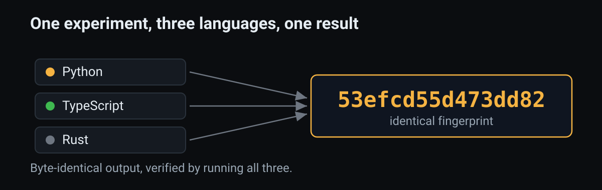

<p align="center">
  
</p>

<p align="center">
  
  
  
</p>

**twinrun answers one question about a computer simulation. Did my change actually cause this result, or was it just luck?**

## What it is, in plain words

Researchers build pretend worlds in code to test an idea, for example whether couples divorce more when they hold their grudges longer. These worlds run on dice rolls, so each run comes out a little different. Add the grudge rule and you see more divorces, but you cannot tell whether the rule caused it or the dice simply landed differently that time.

twinrun takes the luck out of the comparison. It runs the world twice with the dice landing exactly the same in both runs, and changes only the one rule you are testing in the second run. Same dice, one change, so any difference between the two runs is the rule and not chance. It even shows which individuals the change flipped, not just the totals, and it stamps every run with a short fingerprint so anyone can rerun it and land on the identical result.

## The problem it solves

Simulation results are hard to trust and hard to reproduce, because randomness hides inside every run. When a real change and a lucky roll can produce the same outcome, you cannot cleanly say the change caused the effect, and a reviewer who reruns your model may not get your numbers back. twinrun fixes both at once. It holds the randomness fixed across the two runs, so the effect you measure is the change and nothing else, and it fingerprints each run so the result reproduces exactly.

## Who it is for

People who build agent-based models, meaning simulations of many individuals who each follow rules, to study what happens to the whole. That includes epidemiologists modeling how a disease spreads, economists and demographers modeling households and markets, ecologists modeling populations, and engineers building multi-agent AI systems. If your work depends on saying "this change caused this effect" in a simulation, and on that result holding up when someone else reruns it, this is for you.

## How it works, for the technical reader

**Run a change to a simulation against a perfectly matched twin run, measure exactly which individuals the change affected, and prove the result replays to the same fingerprint.** One small file per language, zero dependencies, not tied to any one model.

- **Twin arms on common random numbers.** It runs the model twice from the same randomness, once with your change and once without, so any difference is the change and not luck.
- **A per-individual effect.** Because the twins share their randomness, you can count exactly which agents the change flipped. Independent runs cannot, since almost every agent differs by chance.
- **A placebo arm.** A no-op intervention must come out byte-identical to control. If it moves, something leaked, and the tool catches it.
- **Verified replay.** Every run carries a 64-bit fingerprint (FNV-1a) of the full state, so a reviewer reruns it and lands on the identical result.

The one rule that makes this hold is named per-agent random streams. Each agent owns its stream, so a treatment that reorders work does not change who draws what. A single global stream silently loses that coupling the moment execution order changes.

On a fresh SIR test model the coupled twins recover a per-individual effect of 2.8 agents where independent runs report 6.0, about half of which is chance.

## The same experiment in three languages

<p align="center"></p>

Pick your stack. Each is one self-contained file with no dependencies.

```
python3 python/trial.py
npx tsx typescript/trial.ts
rustc -O rust/trial.rs -o trial && ./trial
```

All three print the same fingerprint, `53efcd55d473dd82`, and the same numbers. The shared generator is SplitMix64 with integer-only draws, so there is no language-dependent floating point or random behavior to break the match.

## See it run

<p align="center"></p>

## Why the effect comes out cleaner

<p align="center"></p>

Independent runs cannot isolate the real effect, because almost every agent differs by chance. Coupled twins can, and only order-independent per-agent streams keep that coupling when a treatment changes execution order.

## Why use it

Two reasons. First, you get a per-individual causal effect that independent runs cannot give you, since there almost every agent differs by chance and drowns the real signal. Second, anyone can reproduce your result from a fingerprint, in whichever of the three languages they prefer, which answers the reproducibility complaint that follows simulation work. Each build is one file with no dependencies, so adopting it costs nothing and locks you into nothing.

## Compared to other tools

The others are strong at what they do. None gives you matched twins, a per-individual effect, a byte-identical placebo, and verified replay together, which is the gap this fills.

| Tool | Common-random-number twins | Per-individual effect | Byte-identical placebo | Verified replay | What it is |
|---|---|---|---|---|---|
| `twinrun` | Yes | Yes | Yes | Yes | This project, model-agnostic, zero dependencies, three languages |
| `Mesa` (Python) | No | No | No | No | The main Python ABM framework, RNG being reworked |
| `Agents.jl` (Julia) | No | No | No | No | A fast ABM framework, no trial layer |
| `SESSL` (Scala) | Partial | No | No | No | Experiment specs and replications, Scala only |
| `rsocsim` / SOCSIM | No | No | No | Partial | Demographic microsimulation, one global RNG stream |
| `DoWhy` / `EconML` | No | No | No | No | Causal inference on data, outside the simulation |

twinrun is not a modeling framework and does not replace the ones above. It is a thin layer you wrap around a model you already have, in any framework, to run clean experiments on it.

## Proof, on a fresh test model

Running any of the three builds reproduces these results. The SIR outbreak model in each file is only a test fixture, written in the file, not imported from anywhere.

- Four invariants pass. Deterministic replay to a fingerprint, placebo byte-identical to control, named streams survive an order change, a single global stream desyncs on one.
- The per-individual effect is 2.8 agents under coupled twins and 6.0 under independent runs, where roughly half of the independent figure is chance.
- When the treatment reorders work, named streams hold at the true 2.8 while a global stream inflates to 5.5 spurious flips.
- Python, TypeScript, and Rust all print the same fingerprint, `53efcd55d473dd82`, with byte-identical output.

## Status

Early. This is the standalone core, extracted from a reproducible marriage and divorce agent-based model called LoveWorld and rebuilt here with no ties back to it, with reference implementations in Python, TypeScript, and Rust. Feedback and issues are welcome.

## License

MIT. See LICENSE.
