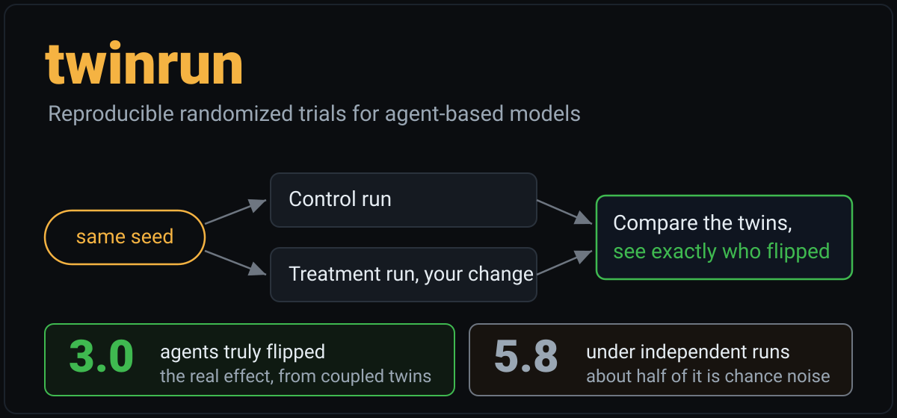
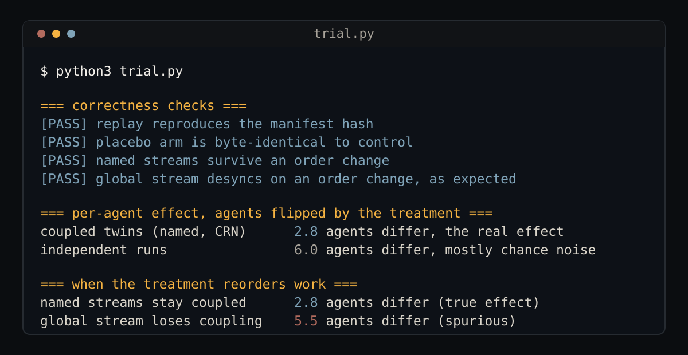
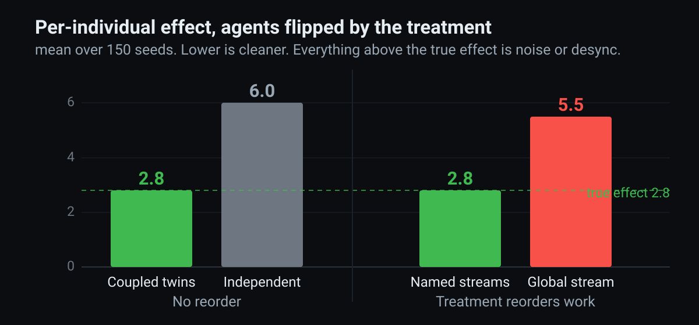

<p align="center">
  
</p>

<p align="center">
  
  
  
</p>

**Run a change to a simulation against a perfectly matched twin run, measure exactly which individuals the change affected, and prove the result replays to the same hash.** One small Python file, zero dependencies, not tied to any one model. On a fresh SIR test model the coupled twins recover a per-individual effect of 3.0 agents where independent runs report 6.1, about half of which is chance.

Run it with `python3 trial.py`, then read the top of [trial.py](trial.py) to see the four building blocks.

## Who it is for

People who build agent-based models, meaning programs that simulate many individual agents following rules to study what emerges in the whole. That includes epidemiologists modeling outbreaks, economists and demographers modeling households and markets, ecologists modeling populations, and engineers building multi-agent systems. If you run a model to ask whether an intervention changes an outcome, and you need that answer to be credible and reproducible, this is for you.

## What it does

- **Twin arms on common random numbers.** It runs the model twice from the same randomness, once with your change and once without, so any difference is the change and not luck.
- **A per-individual effect.** Because the twins share their randomness, you can count exactly which agents the change flipped. Independent runs cannot, since almost every agent differs by chance.
- **A placebo arm.** A no-op intervention must come out byte-identical to control. If it moves, something leaked, and the tool catches it.
- **Verified replay.** Every run carries a SHA-256 manifest, so a reviewer reruns it and lands on the identical result.

The one rule that makes this hold is named per-agent random streams. Each agent owns its stream, so a treatment that reorders work does not change who draws what. A single global stream silently loses that coupling the moment execution order changes.

## See it run

<p align="center"></p>

## Why the effect comes out cleaner

<p align="center"></p>

Independent runs cannot isolate the real effect, because almost every agent differs by chance. Coupled twins can, and only order-independent per-agent streams keep that coupling when a treatment changes execution order.

## Why use it

Two reasons. First, you get a per-individual causal effect that independent runs cannot give you, since there almost every agent differs by chance and drowns the real signal. Second, anyone can reproduce your result from a manifest, which answers the reproducibility complaint that follows simulation work. It is one file with no dependencies, so adopting it costs nothing and locks you into nothing.

## Compared to other tools

The others are strong at what they do. None gives you matched twins, a per-individual effect, a byte-identical placebo, and verified replay together, which is the gap this fills.

| Tool | Common-random-number twins | Per-individual effect | Byte-identical placebo | Hash-verified replay | What it is |
|---|---|---|---|---|---|
| `twinrun` | Yes | Yes | Yes | Yes | This project, model-agnostic, zero dependencies |
| `Mesa` (Python) | No | No | No | No | The main Python ABM framework, RNG being reworked |
| `Agents.jl` (Julia) | No | No | No | No | A fast ABM framework, no trial layer |
| `SESSL` (Scala) | Partial | No | No | No | Experiment specs and replications, Scala only |
| `rsocsim` / SOCSIM | No | No | No | Partial | Demographic microsimulation, one global RNG stream |
| `DoWhy` / `EconML` | No | No | No | No | Causal inference on data, outside the simulation |

twinrun is not a modeling framework and does not replace the ones above. It is a thin layer you wrap around a model you already have, in any framework, to run clean experiments on it.

## Proof, on a fresh test model

Running `python3 trial.py` reproduces these results. The SIR outbreak model in the file is only a test fixture, written in the file, not imported from anywhere.

- Four invariants pass. Deterministic replay to a manifest hash, placebo byte-identical to control, named streams survive an order change, a single global stream desyncs on one.
- The per-individual effect is 3.0 agents under coupled twins and 6.1 under independent runs, where roughly half of the independent figure is chance.
- When the treatment reorders work, named streams hold at the true 3.0 while a global stream inflates to 5.5 spurious flips.

## Quick start

```
python3 trial.py
```

No install, no dependencies. Read the top of `trial.py` to see the four building blocks, then wrap your own model the same way the SIR fixture is wrapped.

## Status

Early. This is the standalone core, extracted from a reproducible marriage and divorce agent-based model called LoveWorld and rebuilt here with no ties back to it. Feedback and issues are welcome.

## License

MIT. See LICENSE.
